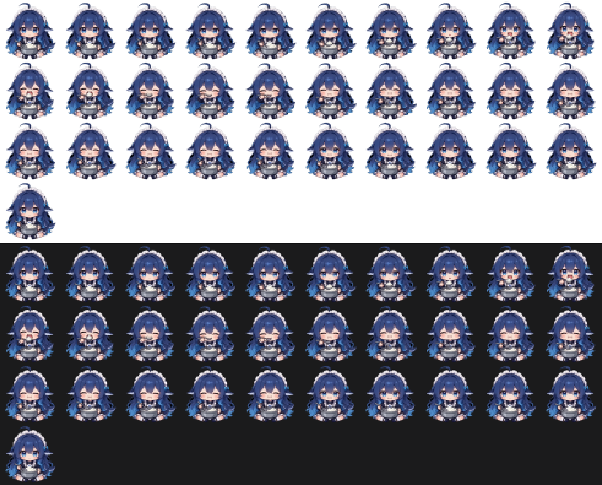

# dsh-rice-bowl · 边吃边想

给 [DeepSeek Harness](https://github.com/deepseek-ai/deepseek-harness)（DSH）的 Web 界面挂一个小动画：
等回复的时候，「深度求索中，用时 N 秒 ···」这一行的末尾会多出一个抱着一大碗白米饭、一勺一勺吃的小家伙。

```
深度求索中，用时 12秒 ···        ← 原样
深度求索中，用时 12秒 ··· 🍚     ← 装上之后
```

回答开始输出、或者这一轮结束，整行消失，动画跟着消失。



## 特点

- CSS `steps()` 逐帧播放，没有 JS 逐帧循环，不吃 CPU。
- 不联网、不读对话内容、不上传任何东西。
- 跟随系统的「减少动效」偏好：开了就只显示静止帧。
- 带设置页：动画、大小（32–64px）、节奏（慢/正常/快），改完立刻生效。
- 当前素材：62 帧、48×48、单帧 66ms（一轮 4.09 秒），雪碧图 205 KB，`lib/client.js` 287 KB，不额外请求图片。

## 安装

```bash
dsh plugin --profile web add github:Luoxiaoyi956/dsh-rice-bowl
```

装完**重启 DSH**，刷新页面。之后「设置」左侧导航会多出一项 **边吃边想**。

本地改着玩：

```bash
dsh plugin --profile web add link:/绝对/路径/dsh-rice-bowl
```

卸载：

```bash
dsh plugin --profile web remove dsh-rice-bowl
```

## 设置

设置页里可以调：

| 项目 | 选项 |
| --- | --- |
| 动画 | 现在只有「鲸鱼娘吃饭」，另有「更多动画」的占位 |
| 大小 | 32 / 40 / 48 / 56 / 64 px |
| 节奏 | 慢 / 正常 / 快 |
| 预览 | 就地显示当前效果 |

设置存在浏览器 `localStorage`（key `dsh-rice-bowl:settings:v1`），不联网；换浏览器或清站点数据会回默认值。改完立刻生效，不用重启。

## 自己换素材

不需要 `npm install`，只要 Node 18+。

**有视频（纯色背景，或者透明被压成纯色的 MP4）**

```bash
# 1. 拆原始帧
ffmpeg -y -i 你的视频.mp4 -an -vf "scale=960:540:flags=area" -pix_fmt rgb24 -f rawvideo frames-raw/video.rgb

# 2. 抠背景 + 裁切 + 缩放 + 出雪碧图（覆盖 assets/rice-sheet.png）
node tools/video-to-frames.mjs --raw frames-raw/video.rgb --w 960 --h 540 --size 48 --every 2

# 3. 打包进插件
node tools/build.mjs --ms 66 --render auto
```

抠图是从画面四边做洪水填充，只吃掉"跟边缘连通的背景色"，角色内部的深色不会丢；颜色按预乘 alpha 面积平均，边缘不发黑。

**源自带透明通道**（WebM/VP9、ProRes 4444、APNG、透明 GIF）就不需要抠：

```bash
# WebM/VP9 必须显式指定 libvpx-vp9 解码器，默认解码器会把 alpha 丢掉
ffmpeg -c:v libvpx-vp9 -i 透明源.webm -an -vf "scale=480:270:flags=area" -pix_fmt rgba -f rawvideo frames-raw/v.rgba
node tools/video-to-frames.mjs --raw frames-raw/v.rgba --w 480 --h 270 --size 48 --every 2 --alpha
```

**有逐帧 PNG** 最省事：放进 `frames/`（正方形、同尺寸、透明底），然后

```bash
node tools/build.mjs --frames --ms 66 --render auto
```

常用参数：

- `--size 40 / 48 / 56 / 64`：画格边长，越大越清楚、文件越大（48→205KB，64→346KB）
- `--every 2`：每 2 帧取 1 帧；`1` = 全帧更顺、文件翻倍，`3` = 10fps 更小但快了会顿
- `--tol 30`：背景色容差，抠不干净调小、抠缺了调大
- `--render auto`：柔和插画风；`--render pixelated` 给硬像素画

## 加一套新动画

`tools/client.template.js` 里的 `VARIANTS` 就是动画表，加一项就有新按钮：

```js
var VARIANTS = {
  whale: { label: "鲸鱼娘吃饭", note: "…", frames: 62, sprite: "data:image/png;base64,…", size: 48, ms: 66 },
  // 加第二个动画：换 label 和 sprite 就行
};
```

设置页的选项和预览会自己多出来，不用改别的地方。

## 原理

DSH 目前没给「运行中」那一行开放官方插槽，所以动画是挂在它的 `data-chat-running` 语义标记上的：找到这一行，把元素塞进它最后一个子元素（文字节点）后面。

两层兜底：

- `MutationObserver` 盯着 DOM，行被重建就补回来（150ms 节流）；
- 2 秒一次定时兜底，防止观察者被绕过。

**已知限制**：如果 DSH 将来重做这块 UI、去掉 `data-chat-running`，插件会静默不显示（不报错、不弄坏界面），改 `lib/client.js` 里构建时的 `ROW_SELECTOR` 即可。等官方开出插槽，可以改成官方方式。

## 结构

```
package.json           dsh.bundle + dsh.client 声明、图标
cordis.patch.yml       把插件插进 profile 配置树
lib/index.js           宿主半侧（空壳，这个插件只在浏览器里干活）
lib/client.js          浏览器半侧（构建产物，别手改）
icon.png               插件列表里的图标
assets/rice-sheet.png  雪碧图（62 帧横排）
assets/preview-48.png  全帧预览图
tools/                 构建、视频转帧、冒烟测试、本地预览页
美术规格.md            素材规格与处理流程的记录
```

自检：

```bash
npm test    # 等于 node tools/smoke-test.mjs
```

## 许可

代码 MIT。动画素材版权归作者，未单独授权前请勿商用。
